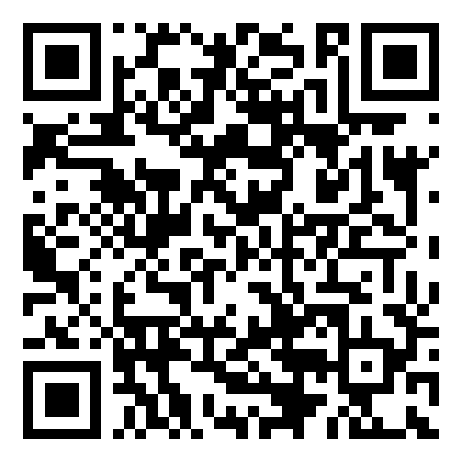

<!-- @format -->

<!-- Addresses live in docs/donate/index.html. Run `npm run donate:qr` after changing them. -->

# 💖 Support image-in-browser

**image-in-browser** is a small library with a fairly big job: decoding and encoding a dozen image formats, in pure TypeScript, in the browser and in Node, with no native dependencies.

It is MIT-licensed. There are no ads, no telemetry, no "pro" tier, and no company behind it. Just me, a text editor, and a growing pile of test images.

If the library saved you an afternoon - or a production incident - you can send a few dollars in crypto. It is optional, one-time, and does not buy features, priority, or influence. The library stays free for everyone.

## What the money goes to

I’m not going to pretend there are server bills. The money buys time:

| Support          | What it covers                                        |
| :--------------- | :---------------------------------------------------- |
| ☕ One coffee    | An hour of issue triage and answering questions       |
| 🧪 A few coffees | A new test fixture or an obscure format edge case     |
| 🛠️ One day       | Dependency upgrades, docs, and a release              |
| 🎯 One week      | Focused work on a codec, performance, or a new format |

The rest goes to the boring stuff: keeping the test suite green and the releases coming.

## Donate

Crypto only. No account, no email, no card, no chargeback. The network fee is paid by the sender; I don’t take a cut.

> [!WARNING]
> **Check the network before sending.** A wrong network or token can be lost for good. If you’re not sure, use USDT on TRON or Bitcoin - those are the least surprising.

### 💵 USDT - TRON (TRC-20)

The default stablecoin option in Ukraine, and usually the cheapest way to send a few dollars.

```
TPTdByy4nWFB9zRxQEqyfQHZFdpX23qjW9
```


> **TRC-20 only.** Not ERC-20, not BEP-20, not Solana. TRX is welcome at the same address.

### ₿ Bitcoin

On-chain. Good for larger amounts; the fee is paid by the sender.

```
bc1qnu22q5xytxq3l78vm4tsexcnrdkt0avjrkaj5x
```


> If you want to send a small amount, USDT on TRON or one of the cheap chains below will cost you less.

### Ξ ETH / USDC - Base

One address for both. Base is an Ethereum L2, so the fee is usually a few cents instead of a few dollars.

```
0x53218b644693AF8fa0c31f5A6df1ACA0DB2E3740
```


> For **ETH**, pick Base. For **USDC**, pick **USDC on Base**. Ethereum mainnet also works, but I’d rather you didn’t pay $5 in gas for a $3 donation.

### 💎 TON

Cheap and quick, especially if you already live in Telegram.

```
UQCSfz3BzVbdfzx7_uOJDbcsvNXN4Enz_eqhCwSkT_JbBg4Q
```


### ✕ XRP

XRP Ledger. Fast, cheap, no smart contracts involved.

```
rpteDv1F57N3s3QngPdddQ89VRXKQ1kEBa
```


> No destination tag needed. If your exchange insists on one, use `0`.

### ◎ Solana - SOL / USDC

```
DWHotA4CKWc3bo4buvreB63LEnWUdQGFRDRCkczTaPr8
```



> For USDC, choose **USDC (SPL)** on Solana.

<details>
<summary>More options: Stellar and Litecoin</summary>

### ✦ Stellar - XLM

Probably the cheapest transfer on this page.

```
GB6GSOEHYR3XPFGIQQMWQDBYJ2YLJ22IWXUFBIRO2P5Y7YMECIIKTGN4
```


> No memo needed. If your exchange insists on one, use `0`.

### Ł Litecoin - LTC

The old-school cheap option.

```
ltc1q47ehc8zsupgzg8d7sl7yj2vcuarj4s7z029f5l
```


</details>

## Which one to pick

| If you want…             | Use                                                                        |
| :----------------------- | :------------------------------------------------------------------------- |
| The least hassle         | USDT on TRON                                                               |
| To send less than $5     | XLM, SOL, XRP, or TON                                                      |
| To avoid stablecoins     | Bitcoin for larger amounts, Litecoin for smaller                           |
| To stay on Ethereum      | ETH or USDC on Base                                                        |
| To send from an exchange | Whatever the exchange charges least for - but check the network name twice |

## A few honest answers

**Is this a subscription?** No. One-time, any amount. I don’t want to run a subscription business.

**Do I get anything?** No. If you want, I’ll add your GitHub handle to the supporters list. That’s it.

**Can I stay anonymous?** Yes. Crypto is pseudonymous. Don’t put your name in the memo if you don’t want it public.

**Why crypto?** Because it’s the only option that works for a solo maintainer in Ukraine without a payment processor taking a cut, holding the money, or asking for a pile of documents. Also, no chargebacks.

**I can’t donate.** Then don’t. Star the repo, report a bug with a repro, improve the docs, or tell someone who needs a browser image codec. That helps more than you’d think.

## A note on trust

These are the only official addresses. I will never DM you first, ask for your seed phrase, or send you a "sponsorship" link. If you see a different address in an issue, PR, or email, it’s a scam.

<!-- Optional: sign a message with each wallet and publish address + message + signature here. -->
